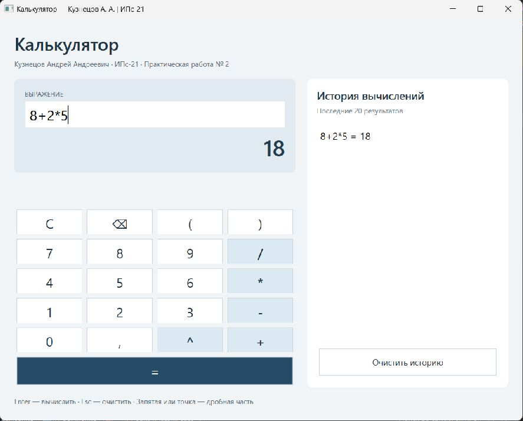
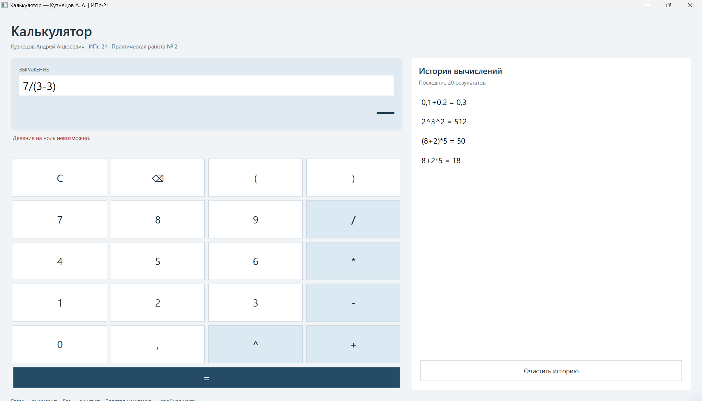
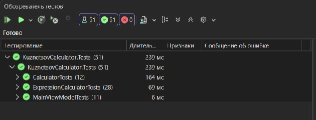
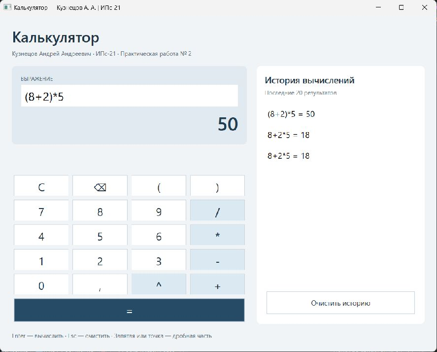
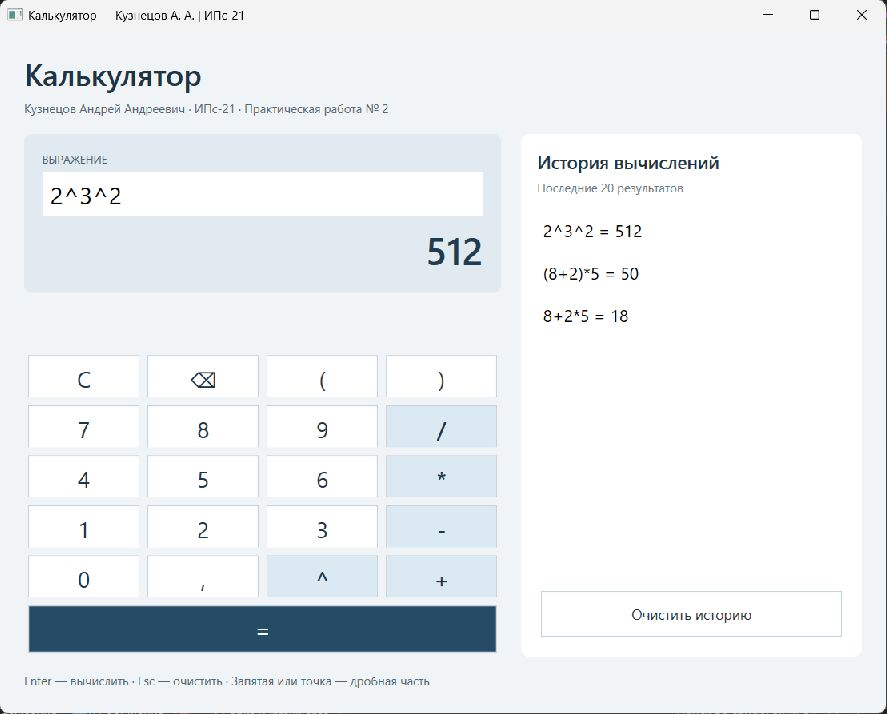
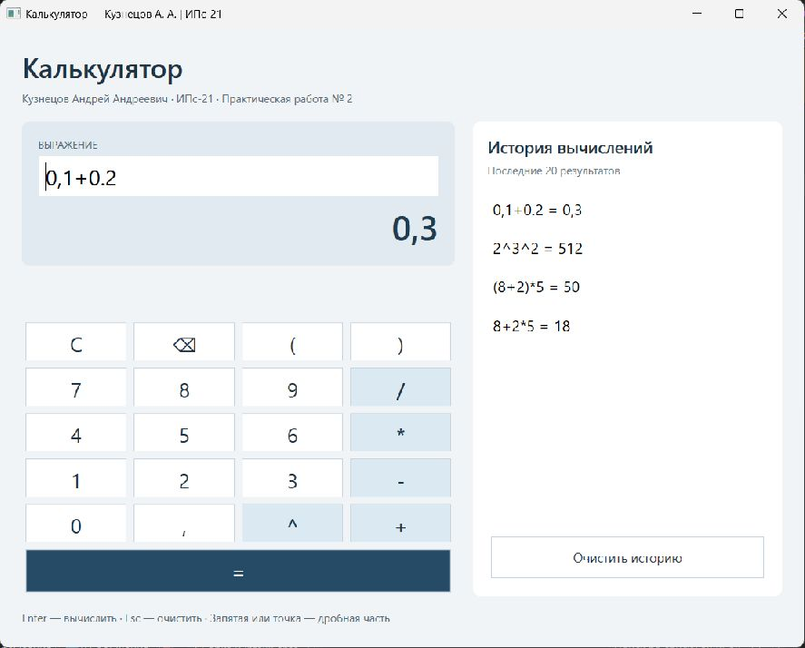

# Практическая работа № 2. Разработка калькулятора на C# и WPF
Кузнецов Андрей Андреевич, ИПс-21. Пермь, 2026.

# ВВЕДЕНИЕ

Практическая работа посвящена разработке калькулятора на языке C# с интерфейсом WPF и автоматической проверкой вычислений. Решение KuznetsovCalculator разделено на библиотеку классов, графическое приложение и проект модульных тестов.

Цель работы - закрепить разделение пользовательского интерфейса и вычислительной логики, научиться проверять арифметические операции независимо от окна программы и документировать полученные результаты. В названии решения и проектов используется фамилия Kuznetsov.

В обязательную часть входят сложение, вычитание, умножение, деление и возведение в степень. Для удобства добавлены ввод выражений, скобки, приоритет операций, поддержка дробных чисел и история последних двадцати успешных расчётов.

# 1 Постановка задачи

Необходимо разработать простую программу «Калькулятор» с использованием Visual Studio и технологии WPF. Основная логика должна находиться в библиотеке классов. Для классов библиотеки требуется написать модульные тесты. Сопроводительная записка содержит титульный лист, содержание и подробное описание действий с иллюстрациями.

Таблица 1 - Операции калькулятора

| Операция | Обозначение | Контрольный пример |
| Сложение | + | 8,5 + 1,5 = 10 |
| Вычитание | - | 3 − 8 = -5 |
| Умножение | * | -4 * 2,5 = -10 |
| Деление | / | 9 / 4 = 2,25 |
| Возведение в степень | ^ | 3 ^ 4 = 81 |

Ввод допускается с экранных кнопок и клавиатуры. При ошибке программа выводит пояснение в окне. Ошибочные вычисления не добавляются в историю; пользователь может исправить выражение и повторить расчёт.

## 1.1 Средства разработки

Используются C#, .NET 8, WPF, XAML и MSTest 4.0.2. Разработка и проверка решения выполнены в Visual Studio Community 2026 версии 18.4.2. Для сборки из командной строки применяется установленный .NET SDK 10.0.201. Целевые платформы проектов - net8.0 и net8.0-windows.

# 2 Структура решения

Решение содержит три проекта. Core не зависит от WPF: его можно использовать и проверять отдельно. Wpf вызывает библиотеку и отображает результат. Tests ссылается на Core и дополнительно подключает MainViewModel.cs как связанный исходный файл для проверки состояния интерфейса без открытия окна.

Таблица 2 - Проекты решения

| Проект | Назначение |
| KuznetsovCalculator.Core | Calculator: арифметические операции; ExpressionCalculator: разбор выражений. |
| KuznetsovCalculator.Wpf | MainWindow.xaml и обработчики; MainViewModel, история и сообщения об ошибках. |
| KuznetsovCalculator.Tests | Проверка операций, выражений и состояния модели представления. |

```csharp
KuznetsovCalculator.Wpf   -> KuznetsovCalculator.Core
KuznetsovCalculator.Tests -> KuznetsovCalculator.Core
Tests: связанный файл MainViewModel.cs из проекта Wpf
```

Разделение позволяет проверять вычисления без зависимости от расположения кнопок. Графическое окно содержит только обработчики пользовательского ввода и привязки данных. Правила арифметики реализованы в Core.

# 3 Создание решения в Visual Studio

В стартовом окне Visual Studio выбирается «Создать проект». Для интерфейса используется шаблон «Приложение WPF», язык C# и платформа .NET 8. Имя проекта задаётся KuznetsovCalculator.Wpf, имя решения - KuznetsovCalculator. В проекте создаются App.xaml и MainWindow.xaml.

Через контекстное меню решения добавляется библиотека классов KuznetsovCalculator.Core. Вместо шаблонного Class1.cs создаются Calculator.cs и ExpressionCalculator.cs. Затем добавляется проект MSTest KuznetsovCalculator.Tests. В него включаются три файла тестов и настройки параллельного выполнения.

## 3.1 Добавление ссылок на проекты

В разделе «Зависимости» проекта Wpf выбирается добавление ссылки на проект и отмечается Core. Такая же ссылка на Core добавляется в Tests. В файлах .csproj появляется ProjectReference. Для MainViewModel.cs в тестовом проекте используется элемент Compile с атрибутом Link.

В файлах проектов WPF и тестов указана ссылка ProjectReference на KuznetsovCalculator.Core.csproj. Это позволяет собирать одну библиотеку вычислений для интерфейса и автоматических проверок.

## 3.2 Сборка и запуск приложения

В Обозревателе решений Wpf назначается запускаемым проектом. Выполняется «Сборка» - «Построить решение», затем запуск F5 или Ctrl+F5. Для открытия готового комплекта используется KuznetsovCalculator.sln. Пакеты тестового проекта восстанавливаются из NuGet.

```csharp
dotnet restore KuznetsovCalculator.sln
dotnet build KuznetsovCalculator.sln -c Release
dotnet run --project KuznetsovCalculator.Wpf -c Release
```

# 4 Разработка библиотеки классов

## 4.1 Класс Calculator

Calculator предоставляет Add, Subtract, Multiply, Divide и Power. Методы принимают два числа double; Power использует Math.Pow. Calculate выбирает операцию по переданному символу.

Нулевой делитель вызывает DivideByZeroException. Метод Check отклоняет NaN и бесконечность в аргументах и результате. Так обнаруживаются переполнение и степень, не имеющая действительного значения.

```csharp
public double Divide(double a, double b)
    {
        if (b == 0)
            throw new DivideByZeroException("Деление на ноль невозможно.");
        return Check(a, b, a / b);
    }
```

## 4.2 Класс ExpressionCalculator

ExpressionCalculator разбирает строку методом рекурсивного спуска. Отдельные методы Parser соответствуют уровням грамматики: Sum - сложение и вычитание, Product - умножение и деление, Unary - унарные знаки, Power - степень, Atom - число или скобки.

```csharp
Sum     -> Product { ('+' | '-') Product }
    Product -> Unary   { ('*' | '/') Unary }
    Unary   -> '+' Unary | '-' Unary | Power
    Power   -> Atom [ '^' Unary ]
    Atom    -> число | '(' Sum ')'
```

При чтении степени правый операнд снова разбирается через Unary. Благодаря этому 2^3^2 интерпретируется как 2^(3^2) и даёт 512. Унарный минус применяется после степени: -3^2 = -9, тогда как (-3)^2 = 9.

Для дробей допускаются точка и запятая; при разборе используется CultureInfo.InvariantCulture. Пробелы разрешены между элементами. Проверка полного чтения строки обнаруживает лишние символы и отсутствующие операторы.

Ввод ограничен 256 символами. Ошибки формата вызывают FormatException с позицией ошибки. Результат округляется до десяти знаков после запятой.

# 5 Разработка интерфейса WPF

## 5.1 Разметка окна

В MainWindow.xaml задаются заголовок с фамилией и группой, размер окна 900 × 720 и минимальный размер 800 × 690. Основная сетка содержит заголовок, рабочую область и подсказку по клавишам. Слева расположены поле выражения, результат и кнопки, справа - история.

Кнопки цифр и операций расположены в UniformGrid из пяти строк и четырёх столбцов. Под сеткой размещена кнопка «=» на всю ширину вычислительной панели. Общие цвета и отступы задаются стилями в App.xaml; операторы выделены отдельным стилем.



## 5.2 Модель представления и обработчики

MainViewModel реализует INotifyPropertyChanged. Свойства Expression, Result и Error связаны с элементами окна. Expression обновляется при вводе благодаря UpdateSourceTrigger=PropertyChanged. Изменения Result и Error уведомляют интерфейс через PropertyChanged.

Обработчик кнопки передаёт её Content в Input. Обработчик «=» вызывает Evaluate, очистка - Clear, удаление символа - Backspace. Арифметические действия из обработчиков не выполняются: Evaluate обращается к ExpressionCalculator из библиотеки.

```csharp
private void Input_Click(object sender, RoutedEventArgs e) =>
        model.Input(((Button)sender).Content.ToString()!);
    private void Evaluate_Click(object sender, RoutedEventArgs e) =>
        model.Evaluate();
```

## 5.3 Ввод с клавиатуры

Клавиша Enter запускает расчёт, Esc очищает выражение и результат. В поле можно редактировать текст обычными средствами TextBox. Обработчик PreviewTextInput поддерживает ввод цифр и операций, когда фокус находится на кнопках, и начинает новый ввод после завершённого вычисления. Знак «=» также запускает расчёт.

## 5.4 История вычислений

История представлена ObservableCollection из записей HistoryEntry. Каждая запись хранит исходное выражение и отформатированный результат. Новая запись вставляется в начало списка, а при превышении двадцати элементов самая старая удаляется. История сохраняется только в памяти до закрытия окна.

Щелчок по записи возвращает выражение в поле ввода. После восстановления выбор снимается, а курсор устанавливается в конец строки. Кнопка «Очистить историю» удаляет записи, не меняя текущее выражение.

## 5.5 Продолжение вычислений

После успешного расчёта сохраняется признак HasResult. Если следующая экранная кнопка или вводимый символ является оператором, новое выражение начинается с полученного результата. Если вводится цифра, предыдущее выражение заменяется. Дробный результат использует запятую и корректно читается библиотекой при продолжении расчёта.

## 5.6 Сообщения об ошибках

Evaluate перехватывает ошибки формата и арифметические исключения. Их текст показывается красным под дисплеем. При ошибке новая запись в историю не добавляется; вместо результата на дисплее показывается «—». После изменения строки сообщение очищается.



## 5.7 Проверка элементов интерфейса

В запущенном приложении проверены ввод с клавиатуры, расчёт по Enter и кнопке «=», восстановление выражения из истории и новый ввод цифры после результата. Проверка выполнена на собственном окне приложения; изображения в отчёте являются снимками его работы.

# 6 Модульное тестирование

В тестовом проекте используются три класса. CalculatorTests проверяет операции, неизвестный оператор, деление на ноль, переполнение и недействительный результат степени. ExpressionCalculatorTests проверяет грамматику и приоритеты. MainViewModelTests проверяет состояние интерфейса без создания Window.

Таблица 3 - Состав тестового набора

| Класс | Число проверок | Основные сценарии |
| CalculatorTests | 12 | Пять операций, ноль, отрицательная степень, ошибки. |
| ExpressionCalculatorTests | 28 | Скобки, дроби, унарный минус, цепочки степеней, неверный ввод. |
| MainViewModelTests | 11 | История, очистка, восстановление, продолжение расчёта, ошибка. |
| Всего | 51 | Все проверки пройдены. |

Для однотипных вычислений используются DataRow. Один метод теста вызывается для нескольких наборов входных данных. Поэтому число проверок в Обозревателе тестов больше числа методов с TestMethod. Числовые результаты сравниваются с допуском 0,000000001.

```csharp
[TestMethod]
    [DataRow("8+2*5", 18.0)]
    [DataRow("(8+2)*5", 50.0)]
    [DataRow("2^3^2", 512.0)]
    public void Calculate_Expression_ReturnsExpected(
        string expression, double expected) =>
        Assert.AreEqual(expected,
            new ExpressionCalculator().Calculate(expression), 0.000000001);
```

## 6.1 Запуск и результаты тестирования

В Visual Studio выбирается «Тест» - «Запуск всех тестов». После сборки и обнаружения методов Обозреватель тестов показывает 51 пройденную проверку: 12 операций, 28 выражений и 11 сценариев модели представления. Непройденных и пропущенных проверок нет.



Повторный запуск из командной строки выполняется командой ниже. Сохранённый файл calculator-final.trx содержит результаты всех проверок, а calculator-final.txt - текстовый итог. Сборка Release завершена с нулём ошибок и предупреждений.

```csharp
dotnet test KuznetsovCalculator.sln -c Release
```

# 7 Проверка работы программы

После модульных тестов выполнены контрольные вычисления в работающем окне. Для сравнения приоритета выбраны одинаковые числа со скобками и без них. В первом случае получается 18, во втором - 50, поскольку порядок действий меняется.



Таблица 4 - Результаты контрольных вычислений

| Выражение | Ожидается | Получено |
| 8+2*5 | 18 | 18 |
| (8+2)*5 | 50 | 50 |
| 2^3^2 | 512 | 512 |
| 0,1+0.2 | 0,3 | 0,3 |

Степени вычисляются справа налево. Для 2^3^2 сначала получается 3^2 = 9, затем 2^9 = 512. Результат и исходная запись помещаются в историю.



При сложении дробей 0,1+0.2 поддерживаются оба разделителя. После округления результат отображается как 0,3. История содержит исходное выражение с введёнными пользователем символами.



## 7.1 Проверка обработки ошибок

Для 7/(3-3) содержимое скобок равно нулю, поэтому программа выводит «Деление на ноль невозможно.». Ошибочная строка не добавляется в историю. После щелчка по прежней записи 2^3^2 выражение восстановилось; нажатие кнопки «=» снова дало 512.

Незакрытая скобка, лишний символ, пустая строка и пропущенный операнд проверяются автоматическими тестами. Дробная степень отрицательного числа и переполнение также приводят к контролируемым исключениям вместо вывода NaN или бесконечности.

# 8 Размещение проекта на GitHub

В корень репозитория включаются решение KuznetsovCalculator.sln, три папки проектов, Directory.Build.props, .gitignore и README. Папка docs содержит PDF, исходный текст записки, реальные снимки интерфейса и протоколы тестирования.

Служебные папки bin, obj, .vs и TestResults исключаются. Для повторной сборки на другом компьютере достаточно исходных файлов, подходящей Visual Studio с компонентами WPF и доступа к NuGet. Установка пакетов выполняется при восстановлении решения.

Название репозитория для этой работы - Kuznetsov-Calculator-PR2. Перед передачей ссылки необходимо проверить доступность исходников и PDF. Тема сопроводительного письма по заданию: «ИПс-21, Кузнецов Андрей Андреевич, Практическая работа 2».

https://github.com/waw9991/Kuznetsov-Calculator-PR2

# ЗАКЛЮЧЕНИЕ

Разработан калькулятор KuznetsovCalculator на C# и WPF. Выполняются пять требуемых арифметических операций; вычислительная часть выделена в библиотеку классов. Реализованы разбор выражений, скобки, дробные числа, история и сообщения об ошибках.

Поведение библиотеки проверено модульными тестами. Дополнительно протестирована модель представления: ограничение истории, восстановление выражения и переход от результата к новому вычислению. Все 51 проверка успешно выполнены в Visual Studio и из командной строки.

Контрольные вычисления в работающем окне подтвердили приоритет операций, вычисление степеней справа налево и поддержку десятичных разделителей. Исходники, иллюстрации и описание соответствуют подготовленному решению.

# СПИСОК ИСПОЛЬЗОВАННЫХ ИСТОЧНИКОВ

1. Metanit. Руководство по C# и .NET. URL: https://metanit.com/sharp/tutorial/

2. Metanit. Руководство по WPF. URL: https://metanit.com/sharp/wpf/

3. Microsoft Learn. Создание и запуск модульных тестов для управляемого кода. URL: https://learn.microsoft.com/ru-ru/visualstudio/test/walkthrough-creating-and-running-unit-tests-for-managed-code?view=vs-2022

4. CoderNet. Модульное тестирование (юнит-тестирование). URL: https://codernet.ru/articles/drugoe/modulnoe_testirovanie_yunit-testirovanie_chto_eto_tipyi_instrumentyi/

5. Microsoft. MSTest. URL: https://github.com/microsoft/testfx

# ПРИЛОЖЕНИЕ А Класс Calculator

```csharp
namespace KuznetsovCalculator.Core;

/// <summary>Пять арифметических операций над действительными числами.</summary>
public class Calculator
{
    public double Add(double a, double b) => Check(a, b, a + b);
    public double Subtract(double a, double b) => Check(a, b, a - b);
    public double Multiply(double a, double b) => Check(a, b, a * b);

    public double Divide(double a, double b)
    {
        if (b == 0)
            throw new DivideByZeroException("Деление на ноль невозможно.");
        return Check(a, b, a / b);
    }

    public double Power(double a, double b) => Check(a, b, Math.Pow(a, b));

    public double Calculate(double a, char operation, double b) => operation switch
    {
        '+' => Add(a, b),
        '-' => Subtract(a, b),
        '*' => Multiply(a, b),
        '/' => Divide(a, b),
        '^' => Power(a, b),
        _ => throw new ArgumentException("Неизвестная операция.", nameof(operation))
    };

    private static double Check(double a, double b, double result)
    {
        if (!double.IsFinite(a) || !double.IsFinite(b) || !double.IsFinite(result))
            throw new ArithmeticException(
                "Результат не является конечным действительным числом.");
        return result;
    }
}
```

# ПРИЛОЖЕНИЕ Б Класс ExpressionCalculator

```csharp
using System.Globalization;

namespace KuznetsovCalculator.Core;

/// <summary>Разбор выражения по уровням приоритета операций.</summary>
public class ExpressionCalculator
{
    public double Calculate(string expression)
    {
        if (string.IsNullOrWhiteSpace(expression))
            throw new FormatException("Введите выражение.");
        if (expression.Length > 256)
            throw new FormatException("Выражение должно содержать не более 256 символов.");
        return new Parser(expression).Parse();
    }

    private sealed class Parser(string text)
    {
        private readonly Calculator calculator = new();
        private int position;

        public double Parse()
        {
            double result = Sum();
            SkipSpaces();
            if (position != text.Length)
                throw Error("Лишний символ или отсутствует оператор");
            return Math.Round(result, 10);
        }

        private double Sum()
        {
            double value = Product();
            while (true)
            {
                if (Take('+')) value = calculator.Add(value, Product());
                else if (Take('-')) value = calculator.Subtract(value, Product());
                else return value;
            }
        }

        private double Product()
        {
            double value = Unary();
            while (true)
            {
                if (Take('*')) value = calculator.Multiply(value, Unary());
                else if (Take('/')) value = calculator.Divide(value, Unary());
                else return value;
            }
        }

        private double Unary()
        {
            if (Take('+')) return Unary();
            if (Take('-')) return -Unary();
            return Power();
        }

        private double Power()
        {
            double value = Atom();
            // Правый операнд читает следующую степень: 2^3^2 = 2^(3^2).
            return Take('^') ? calculator.Power(value, Unary()) : value;
        }

        private double Atom()
        {
            if (Take('('))
            {
                double value = Sum();
                if (!Take(')')) throw Error("Ожидается закрывающая скобка");
                return value;
            }

            SkipSpaces();
            int start = position;
            while (position < text.Length && char.IsAsciiDigit(text[position])) position++;
            if (position < text.Length && text[position] is '.' or ',')
            {
                position++;
                while (position < text.Length && char.IsAsciiDigit(text[position]))
                    position++;
            }
            string number = text[start..position].Replace(',', '.');
            if (!double.TryParse(number, NumberStyles.AllowDecimalPoint,
                    CultureInfo.InvariantCulture, out double parsed)
                || !double.IsFinite(parsed))
                throw Error("Ожидается корректное число");
            return parsed;
        }

        private bool Take(char symbol)
        {
            SkipSpaces();
            if (position >= text.Length || text[position] != symbol) return false;
            position++;
            return true;
        }

        private void SkipSpaces()
        {
            while (position < text.Length && char.IsWhiteSpace(text[position])) position++;
        }

        private FormatException Error(string message) =>
            new($"{message} (позиция {position + 1}).");
    }
}
```
